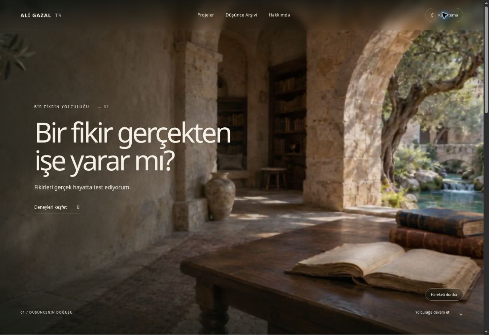
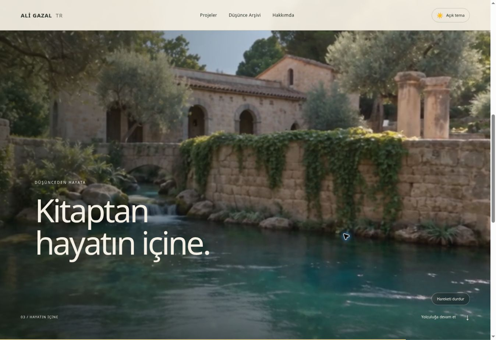
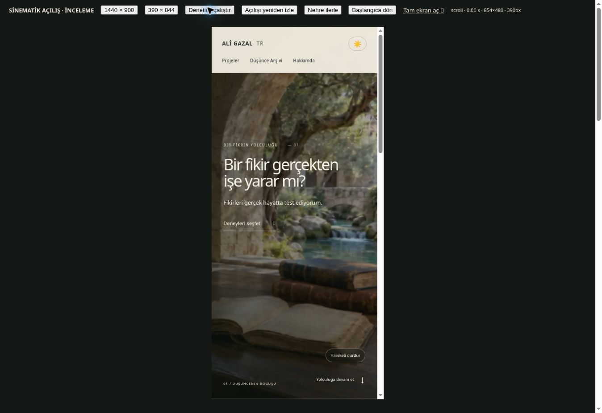
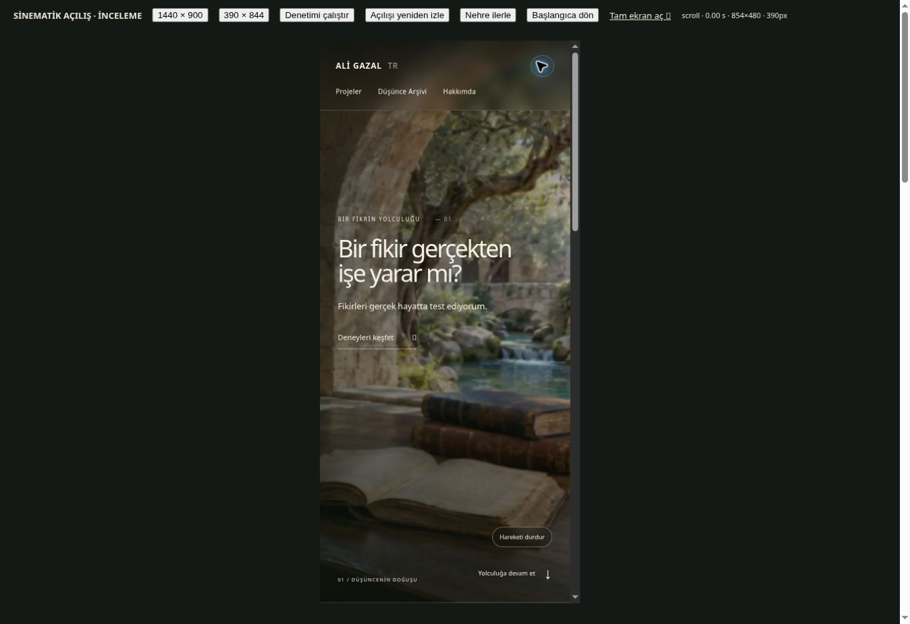

# İlk sinematik açılış prototipi

Mevcut PR #33 ve bütün ürün sayfaları korunur. Yeni çalışma `feature/cinematic-opening-v1` dalında, `915145ce20802287ccf7a7489917b71c9ea5d90b` üzerine eklenmiştir. Ana sayfanın ilk yolculuğu `/cinematic-opening` adresinde izole edilmiştir; mevcut `index.html` değişmemiştir.

- [Üç alternatif](alternatives.webp), [seçilen 02](selected.webp), [beş kamera karesi](storyboard.webp).
- [Gerçek üretilen hareket](generated-motion-original.mp4). Kaynak film 854×480, 24 FPS, 241 kare, 10.041667 saniyedir. Görseller kavramsal storyboard'dur, hareket kanıtı değildir.
- Web filmi `../../cinematic-film.mp4`; gerçek HTML başlıkları, 4.8 saniye otomatik açılış ve devamında ileri/geri kaydırma.

**Doğrulanmış önizleme:** https://3e523ca5-ali-gazal-site.aliicerikmedya.workers.dev/cinematic-opening

## Üretim kararı

Mevcut üç özgün alternatif yeniden üretilmedi. İkinci alternatifin taş sövesi, kitaplar, yanal ışık, metin boşluğu ve aynı avluya açılan kemeri en güçlü bağlantıyı veriyor. Dört panelli önceki storyboard ve gerçek başlangıç görseli beş kavramsal adımda korunmuştur.

Higgsfield `hf_mult_motion_control`: daha önce oluşturulmuş Blender kamera filminin ilk 10 saniyesi yalnızca hareket referansıdır. Onaylı ikinci alternatif görünüm referansıdır. Tek ücretsiz üretim hakkı kullanıldı; teklif 0 kredi, bakiye işlemden sonra hâlâ 10 kredi. Satın alma, deneme başlatma veya hak sıfırlama yok.

## Görsel değerlendirme

Kamera kitapların yanından ilerliyor, taş kemerden dışarı açılıyor ve akan suya yaklaşıyor. Fotoğraf yakınlaştırması, fotoğraf çözülmesi, dairesel portal ve boş siyah geçiş kullanılmadı. Malzeme/ışık dili önceki prosedürel Blender filminden daha ayrıntılıdır.

Bu bir nihai yüksek çözünürlüklü teslim değildir: 480p büyük ekranlarda yumuşar; AI taş/bitki ayrıntıları yer yer oynar. Manzara bu kısa çekimde avlu/nehir ölçeğinde kalır. Üretilen film bir 3D model dosyası değildir. Kaydırma durunca filmin su hareketi de durur. Kullanıcının görsel kabulü verilmemiştir.

## Kontroller

108 mevcut Node testi ve statik site kontrolleri geçti. Yeni dosyalar için yayın izin listesine yalnızca yedi öğe eklendi; bu nedenle koruma fixture'ında yalnızca `.assetsignore` hash'i güncellendi. Machiavelli, Control, Projeler, Düşünce Arşivi, Hakkımda ve proje verilerinin içerikleri değişmedi. Gerçek Chrome tarayıcısında 1440 ve 390 CSS piksel genişliklerinde 20/20 kontrol geçti: otomatik oynama, 4.8 saniye devri, ileri/geri kaydırma, ilk kitap karesine dönüş, başlık/menü yerleşimi, tema ve navigasyon. Fiziksel telefon testi değildir. [Ölçüm kaydı](browser-checks.json). İlk başarısız ölçüm de ayrı dosyada korunmuştur; iframe yükleme yarışması ve arka planda kare zamanlaması düzeltildikten sonra tekrarlandı.

Main'e merge ve production yayını yok. İlk yolculuğun ötesine geçilmedi.

İlk gerçek tarayıcı incelemesinde otomatik 4.8 saniye duruşu, nehre kaydırma (8.24 s), kitaplara dönüş (0 s) ve açık/koyu tema görüntülendi. Otomatik iframe denetimi daha sıkı zamanlama ve yeni iframe yüklemesini bekleme ihtiyacını gösterdi; önceki ham sonuçlar `preliminary-browser-checks.json` içinde dürüstçe korunmuştur. Son tekrar denetimi beklenmektedir.

## Görsel kanıtlar

Filmde 241/241 ayrı çözümlenmiş kare var; siyah segment bulunmadı. Yapay büyütme veya kare enterpolasyonu yok. Sonraki üretim kullanıcı görsel değerlendirmesine kadar durduruldu.
