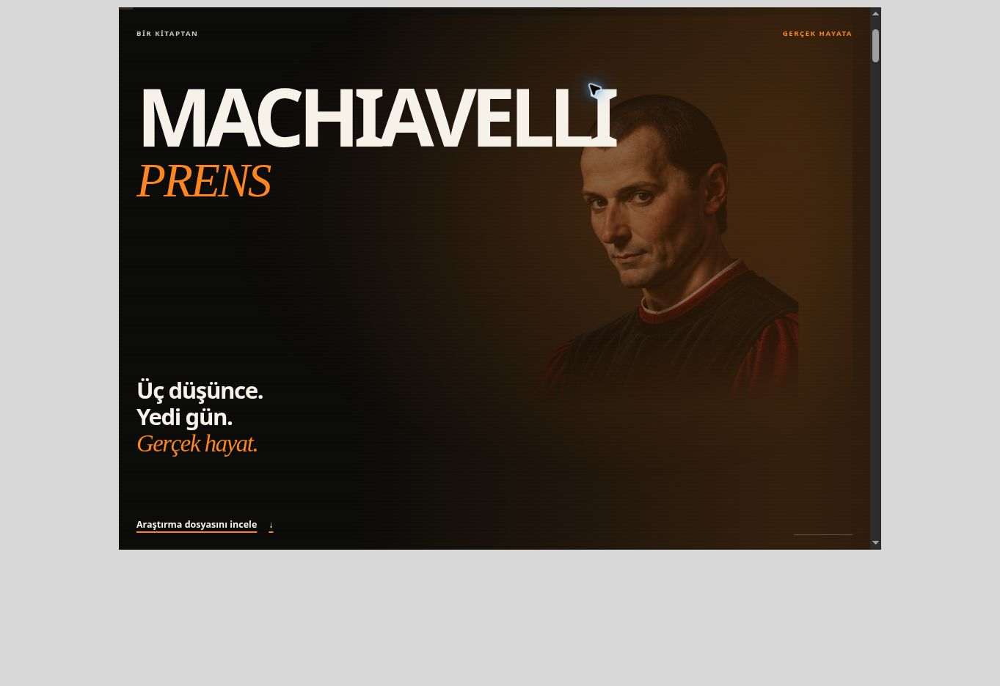
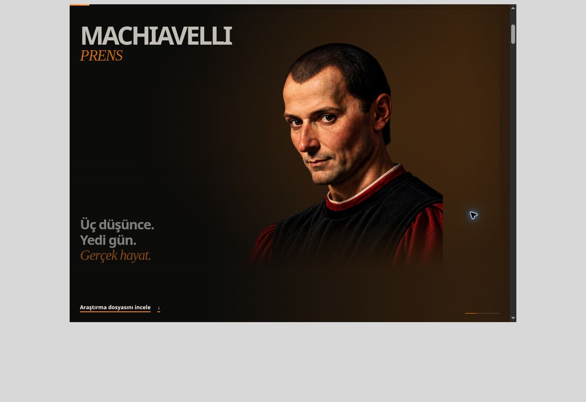
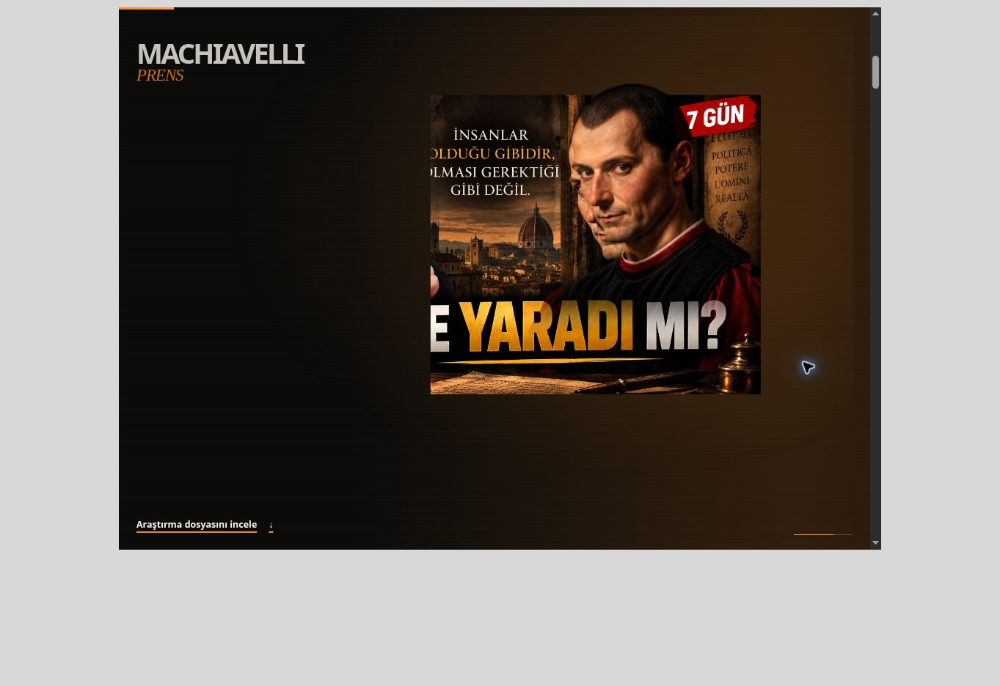
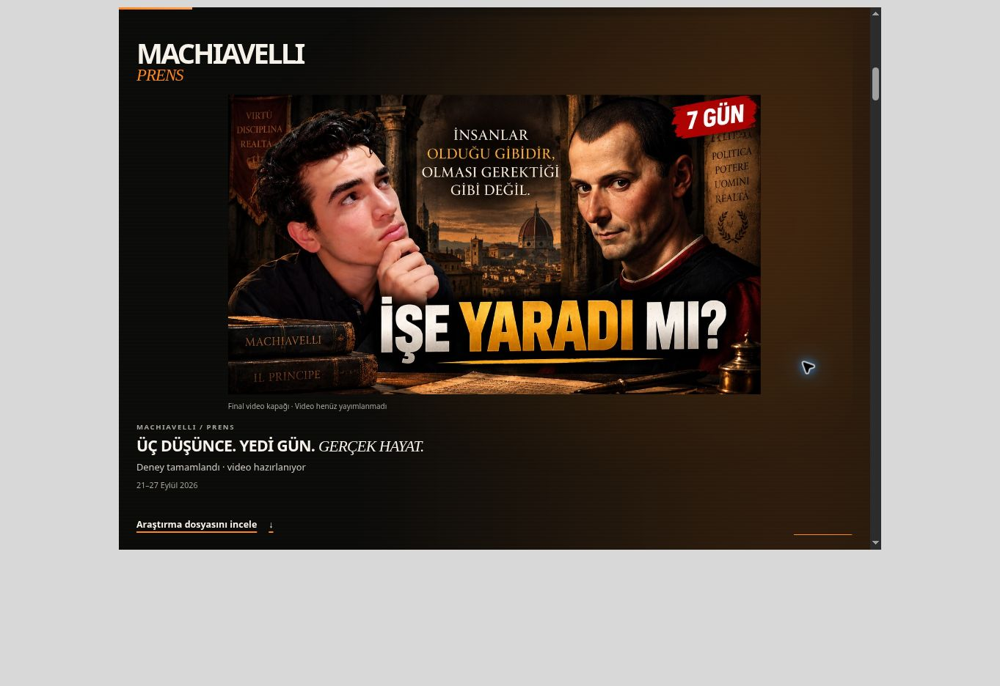
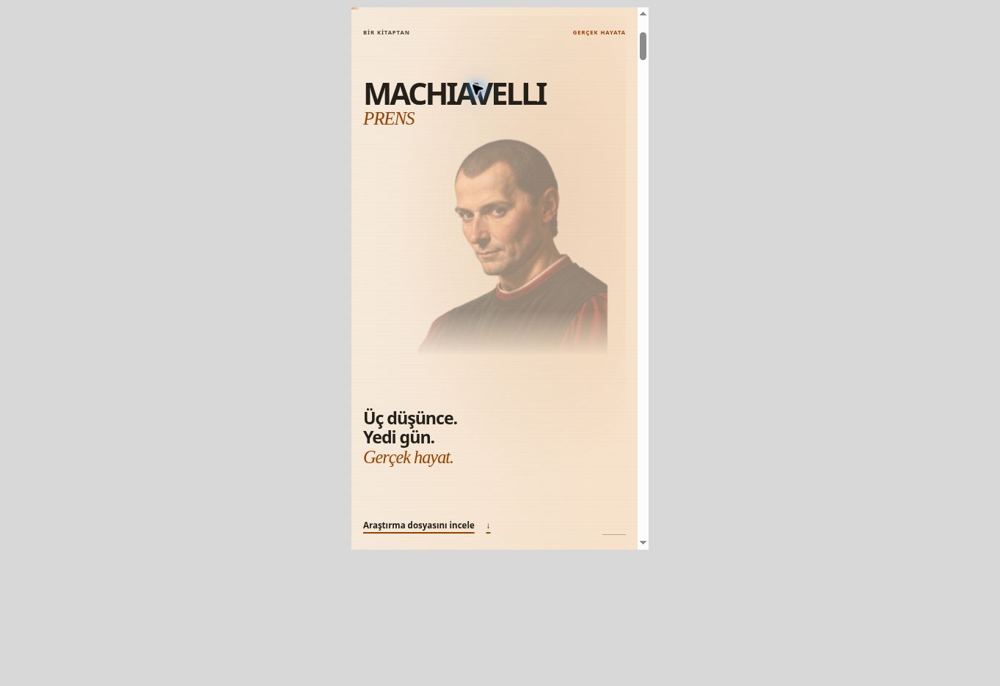
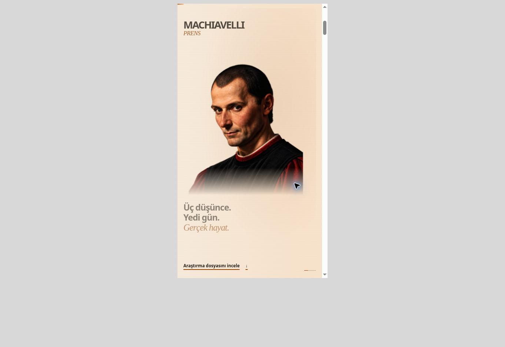
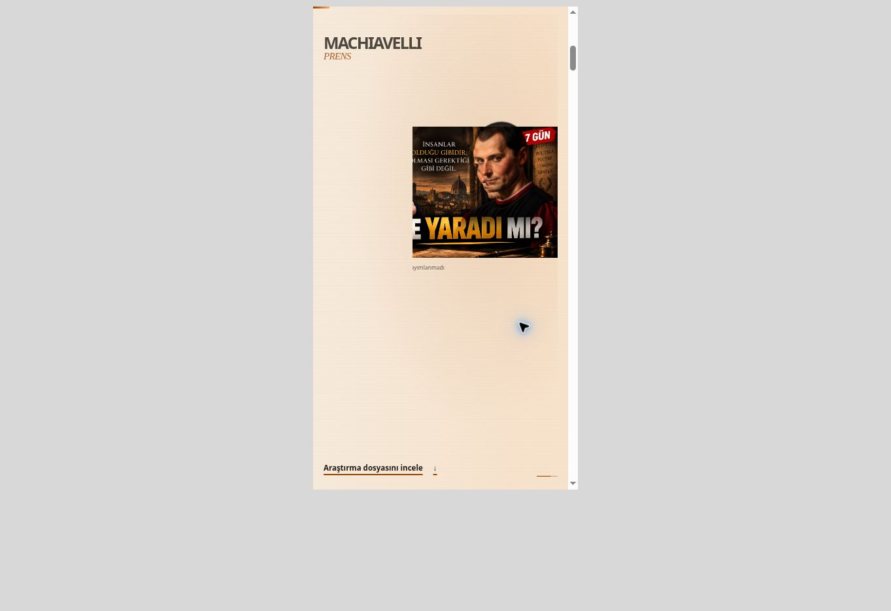
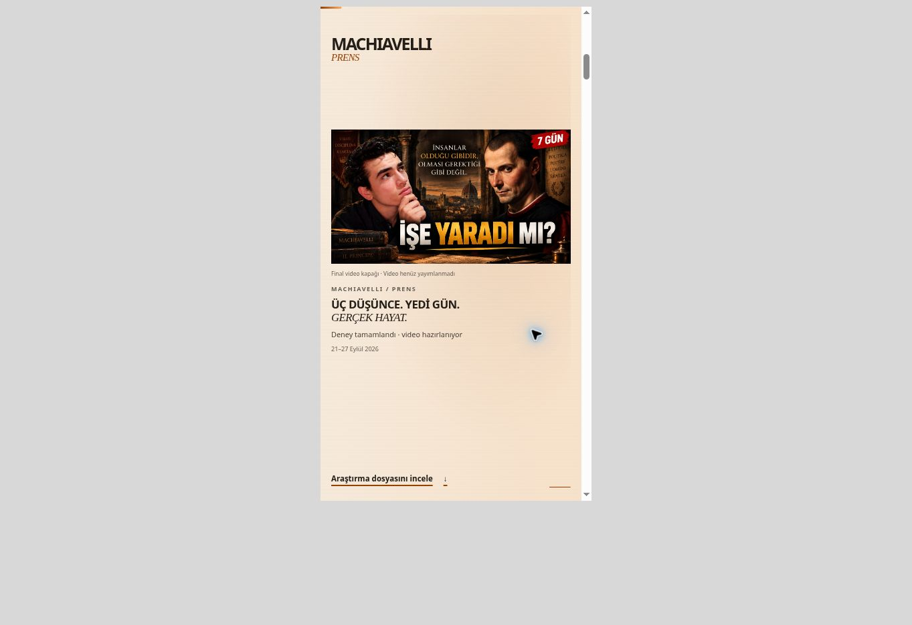
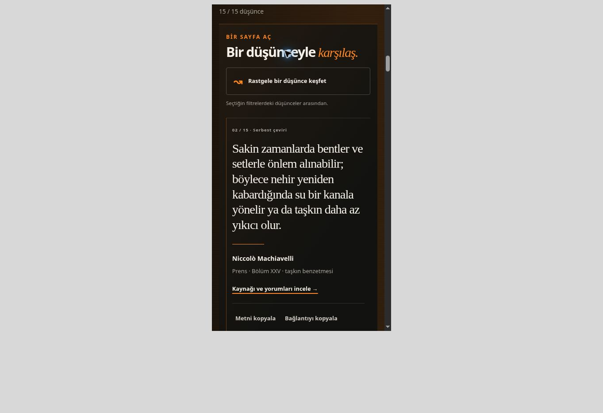

# 4.2 — gerçek tarayıcı görsel kanıtları

Kaynak: `1ef98f41b79d3112b4c4e0d4849c155764eb8e25`, Cloudflare önizleme sürümü `381d80f6-cff2-4dfb-bfc9-edfeda5493ae`.

Bu görüntüler çalışan Machiavelli sayfasından gerçek Chrome ekran görüntüleridir. İlk durum test düzeneğiyle sahne başlangıcına kaydırıldı; sonraki durumlara doğal tarayıcı kaydırmasıyla ulaşıldı. Yapay zekâ ile üretilmiş sayfa maketleri değildir. Gri dış alan test düzeneğinin viewport çevresidir; site tasarımının parçası değildir. Dosyalar yeniden çizilmedi veya kırpılmadı.

Masaüstü viewport **1024 × 740, koyu tema**; telefon viewport **390 × 740, açık tema**. Telefon görüntüleri fiziksel Android cihazdan alınmadı. Diğer genişlik/yükseklik/tema sonuçları yanlarındaki JSON kanıt dosyalarında yer alır.

## Masaüstü

### 01 — Beliriş · ilerleme 0

### 02 — Portre · ilerleme 0.3202

### 03 — Dönüşüm · ilerleme 0.6803

### 04 — Gerçek deney · ilerleme 0.9856

## Telefon

### 01 — Beliriş · ilerleme 0

### 02 — Portre · ilerleme 0.3204

### 03 — Dönüşüm · ilerleme 0.6786

### 04 — Gerçek deney · ilerleme 0.9835

## Arşiv

390 × 740 px, koyu tema. Keşif kartının sabit çerçevesi, yazarı, kaynağı ve bağlantıları korunur. Siyah perde/yaprak DOM'u kaldırıldı; kısa metin hareketleri sürer.

[18 maddelik teslim raporu](../cinematic-v42-review.md) · [Portre kaynağı ve işlem kaydı](../cinematic-v42-portrait.md) · [Dört sahnenin tasarımı](../cinematic-v42-storyboard.md)
