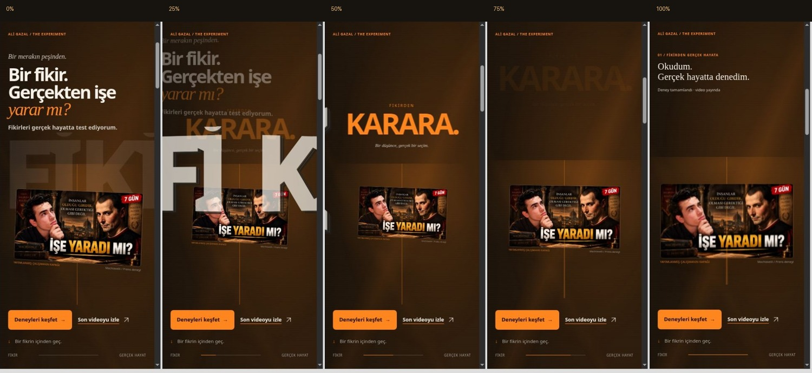
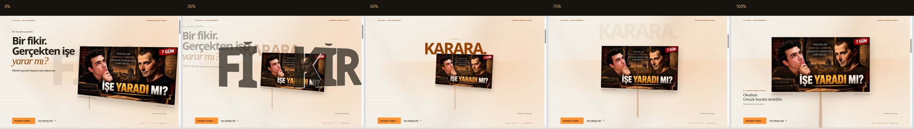
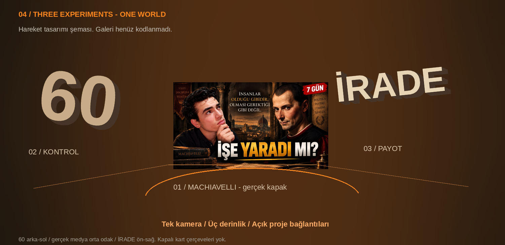
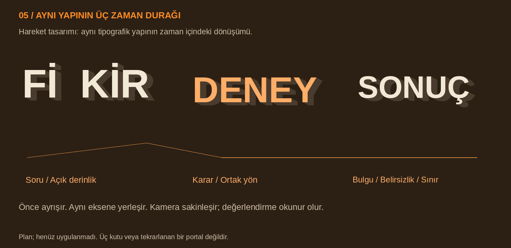

# Aşama 2 - Bir Fikrin Yolculuğu

Temel sürüm: `a1cc3a3504df5757eb4444215606f40e33fea76b`.
Dal: `feature/homepage-cinematic-prototype-v1`.
Kapsam: Sahne 01, Sahne 02 ve Sahne 03'e çalışan geçiş kanıtı.
Sahne 04/05 yalnız hareket tasarımıdır. Production yayını onaylanmadı.

## Çalışan prototip

İlk soru, büyük Fİ/KİR tipografisinin önündedir. Gerçek Machiavelli kapağı
aynı perspektif mekânının orta planında bulunur. Kaydırınca soru geriye
çekilir; Fİ ve KİR iki yanda ileriye taşınır ve dönerek yakın planın dışına
çıkar. Böylece ekranın siyaha kapanması yerine uzakta KARARA odağı ve
gerçek yayımlanmış görsel görülür. Kamera ileri gittikçe mevcut kapak
merkeze gelir ve açısı düzleşir. Görsel bütündür; Ali'nin yüzü kesilmedi,
üretilmedi veya yeniden oluşturulmadı.

Bu, yalnız ölçeklenen bir dikdörtgen değildir: aynı koordinat sisteminde
ileri giden kamera, ters yönlerde açılan iki büyük harf kütlesi, farklı
derinlikte bir karar odağı ve ayrı derinlikte gerçek medya birlikte çalışır.
Kamera ilerlemesi masaüstünde 780, mobilde 580 CSS px'e kadar örneklenir;
CSS perspektifi 1100 px'tir. Bunlar gerçek bir lens veya fiziksel kamera
ölçümü değil, görsel kompozisyonun koordinatlarıdır.

İki CTA sahne dönüşümüne katılmaz. Projeler sayfası ve gerçekten yayımlanmış
son video, hareket beklenmeden açılabilir. Kısa ışık yerleşmesi yaklaşık
1,25 saniyedir; erken kaydırma bunu iptal eder. Otomatik giriş ile scroll
aynı transform değerlerini yönetmez.

## Önce / şimdi

| Aşama 1'de reddedilen | Bu dalda yapılan |
| --- | --- |
| Eğilmiş kâğıdın dönmesi | Yakın/uzak tipografik kütlelerin arasından kamera ilerlemesi |
| Metin değiştiren yüzey | Soru, karar odağı ve gerçek medyanın mekânsal ilişkisi |
| Üç düz kart | Bu dalda galeri kodlanmadı; tek mekânda üç odak tasarlandı |
| Üç ayrı yöntem kâğıdı | Aynı tipografik yapının sorgu/uygulama/değerlendirme dönüşümü planlandı |

## Düzeltilmiş storyboard

### 02 - The Thought Passage / uygulandı

Başlangıçtaki büyük soru okunur. Yaklaşık %8'den itibaren Fİ ve KİR'nin
iki kütlesi iki yanda öne gelir. Katmanlar 4°'lik başlangıç açısından
yaklaşık 54°'ye açılır. Yakın harfler büyürken uzaktaki kapak küçülür;
aynı hızda kayan iki resim görüntüsü oluşmaz. %25'te izleyici harflerin
arasında, araştırma sorusunun içindedir. Hacim, kontrollü kenar gölgeleri
ve perspektifle kurulur; harf başına yüzlerce yüzey kullanılmaz.

KARARA odağı %18-37 arasında belirginleşir. Odağın üst konumu yüzlerin
üstüne metin gelmesini önler. Sonra kamera odağı geride bırakır.
Geçiş Control'ün sıfır boşluğunu kullanmaz. Machiavelli sahnesindeki
portre/kapağın piksel eşleşmesi bu dalda kullanılmadı.

### 03 - From thought to reality / geçiş kanıtı uygulandı

Kamera %40'tan itibaren ilerler. Harf kütleleri kenarlardan çıkarken
gerçek kapak ileri yaklaşır. %75'te soyut düşünce mekânından gerçek
çalışmaya geçiş görünür; %100'de kapak düzleşmiş ve araştırma dosyasına
bağlanmış durumdadır. Kapağa fade-in uygulanmıyor; bütün geçişte aynı
görsel bulunuyor. Dönüşümün ana unsuru konum, derinlik ve bakış açısıdır.

Son durumdaki “Okudum. Gerçek hayatta denedim.” Machiavelli'nin gerçekten
tamamlanmış deneyine aittir. Yanındaki durum, kamuya açık veri kaydından
üretilir. Kapak, gerçek deney anının fotoğrafı gibi sunulmaz;
“Yayımlanmış çalışmanın kapağı” ifadesi ve açıklayıcı alt metin bulunur.

### 04 - Three experiments, one world / yalnız tasarım

Üç dikdörtgen kart yerine tek görüş alanında üç ayrı ağırlık merkezi:
solda uzak ve büyük 60, ortada tamamlanmış Machiavelli çalışmasının gerçek
görseli, sağda daha yakın İRADE tipografisi. Yüzeylerin çevresinde
kapalı kart kenarları veya üç ayrı kutu bulunmaz. Ortak zemin ışığı,
aynı göz hizası ve tek kamera yönü bütünlüğü kurar.

Önerilen ilerleme: ilk %0-30'da kamera orta odakta durur; %30-60'ta
yatay olarak yaklaşık ekranın %12'si kadar kayarak 60'ın ölçeğini ve
derinliğini değiştirir; %60-85'te İRADE daha yakın bir odağa gelir.
Son %15'te kamera sakinleşir ve üç normal proje bağlantısı sahnenin
altında aynı anda görünür. Kullanıcı tüm bu yolculuğu atlayıp bağlantıya
hemen gidebilir. Hover, sürükleme, dönen carousel veya 3D nesneyi seçme
zorunluluğu bulunmaz.

Mobilde üç odak aynı yatay sahneye sıkıştırılmaz. 60 arka-sol, gerçek
medya orta, İRADE üst-sağ bir diyagonal oluşturur. Kısa, ardışık odak
değişimleri yapılır; erişilebilir proje adları ve durumları normal akışta
bulunur. Durumlar `site-data.js`'ten üretilir. Control paylaşım PNG'sindeki
gömülü durum metni, dinamik durum kaynağı olarak kullanılmaz.

Bu galeri henüz kodlanmadı; çizim hareket/yerleşim şemasıdır.

### 05 - Fikir / Deney / Sonuç / yalnız tasarım

Sahne 02'deki iki büyük tipografik kütle tekrar kameranın üstüne
gelmez. Kamera onları geçtikten sonra geride kalan yapının açık
yan yüzleri görünür. Böylece önceki geçişin sonucu kullanılır.

1. **Fikir:** Ayrışmış iki büyük harf kütlesi, aralarında incelenebilir
   bir soru ekseni. Kadraj derin ve açılıdır; bir kitap sayfası değildir.
2. **Deney:** Aynı kütleler ortak eksene dönerek uygulamanın yönünü
   kurar. Gerçek proje görseli öne yerleşir; dekoratif veri, sahte günlük
   veya başarı grafiği belirmez. Harfler parçacıklara dağılmaz.
3. **Sonuç:** Kamera yana yaklaşık 10-15° döner, derinlik sıkışır ve
   yapı okunur bir değerlendirme alanına yerleşir. “Bulgu / Belirsizlik /
   Sınır” bir arayüz anlamı kazanır; üç ayrı kutu veya kâğıt oluşmaz.
   İlgili projenin gerçekten yayımlanmış değerlendirmesine gidilir.

Masaüstünde yaklaşık 600-800 px, mobilde 350-500 px ek scroll bir ilk
varsayımdır. Bu bütçe tüm ana sayfa entegrasyonunda test edilmelidir.
Reduced-motion'da hareket yerine soru, gerçek proje ve değerlendirme
bağlantısı normal akışta kalır. Her projenin başarılı sonuç verdiği ima
edilmez. Canlı Fikir/Deney/Sonuç bölümü bu dalda değiştirilmedi.

## CSS 3D / WebGL kararı

Bu prototip iki büyük harf kütlesi, bir karar odağı ve tek gerçek medya
gerektiriyor. CSS 3D bakış açısı, örtüşme ve kamera ilerlemesini kurdu;
bu nedenle Three.js eklenmedi. Yeni bağımlılık, WebGL context'i,
arka plan videosu, API, worker veya ücretli servis yok.

WebGL ancak sonraki somut görsel hedefte gerçekten hacimli ışık veya
fiziksel geometri gerektiren bir fark gösterirse değerlendirilmelidir.
O durumda görüntü farkı, aktarım boyutu, Android GPU maliyeti, context
kaybı ve statik fallback birlikte karşılaştırılmalı. Bu sürüm WebGL'nin
her koşulda gereksiz olduğunu veya bütün telefonlarda aynı akıcılığı
kanıtlamıyor.

## İzolasyon ve koruma

Yeni dosyalar: `homepage-scene.css`, `homepage-scene.js`,
`homepage-frames.js`, küçük statik renderer ve hedefli testler.
Bu dosyalar yalnız ana sayfada yüklenir. Genel `motion.js`,
`motion.css`, `signature.css` ve `styles.css` değiştirilmedi.

`index.html`'in eski hero altındaki bölümü byte düzeyinde aynı.
`site-data.js`, Machiavelli, Control, Payot dosyaları ve `_headers`
aynen korunuyor; ek hash testi bu sınırı koruyor. Eski koruma listesinde
yalnız açıkça değişen index ve `.assetsignore` hash'i yenilendi.

Yeni üç istemci dosyası `.assetsignore`'a tek tek eklendi. Doküman,
test, yerel QA sayfası veya ham kaynak yayına açılmadı. Yerel viewport
denetimi dosyaları yalnız git tarafından dışlanan `dist` içinde bulunur.
Payot PR #20'ye commit veya merge yapılmadı.

## Test ve bilinen sınırlar

- Tüm statik üretim kontrolleri ve **98 test başarılı**: 93 mevcut test
  (hero yerleşimine bağlı üç beklenti yeni metin/seçicilerle güncellendi)
  ve 5 yeni davranış testi. Eski yayın geri çekme ve URL doğrulama
  güvenceleri kaldırılmadı.
- Yeni testler: kamera sürekliliği ve tersine dönüş; güvenli son yayın
  seçimi; dokunulmaz dosyalar ve alt bölüm; reduced-motion/medya hatası/
  büyük metin fallbackleri; tek frame planlama ve arka planda durma.
- Chromium içinde gerçek 390×844 ve 1440×900 CSS piksel iframe
  görünümlerinde, iki temada %0/25/50/75/100 kontrol edildi. 20 durumda
  görsel yüklendi, yatay taşma görülmedi ve iki CTA başka katman altında
  kalmadı. Bunlar gerçek Android ölçümleri değildir. 1440 görünümünün
  ekran görüntüsü, çalışma ekranına sığması için %84 gösterim ölçeğindedir;
  iframe'in kendi viewport'u 1440 CSS piksel olarak doğrulandı.
- 320/360/430/768 genişliklerde %0/50/100 ek kontrolleri yapıldı.
- Gerçek wheel girişleriyle mobil ilerleme yaklaşık
  0 → .2526 → .5067 → .2526 → 0 olarak gözlemlendi.
- JavaScript kapalı sandbox belgesinde başlık, gerçek görsel ve linkler
  görünür; yatay taşma yok. 390×500 kısa ekran ve %200 kök metin
  senaryosu statik akışa döndü. Büyük metinde CTA doğal olarak aşağıda;
  bir sahne içinde kesilmiyor.
- Reduced-motion ve bozuk medya kontrolü VM fixture'ında doğrulandı;
  gerçek tarayıcı işletim sistemi reduced-motion ayarı ayrıca ölçülmedi.
- Klavyeyle CTA sırası, görünür odak çizgisi ve Enter ile Projeler sayfasına geçiş doğrulandı. Video bağlantısı gerçek yayımlanmış URL’ye işaret ediyor.
- Tarayıcı konsolunda bu yerel uygulamaya ait hata gözlenmedi. Araç
  uzantısının metadata hataları ve JS-kapalı sandbox'ın beklenen script
  engellemeleri ürün hatası olarak sayılmadı.
- İlk kayıt denemesinde kırpılmış screenshot API'si zaman aşımına uğradı;
  desteklenen normal ekran görüntüsüyle kayıt alındı. Başlangıçta eski
  hero seçicisine/metnine bağlı dört test başarısızdı; gerekli beklenti
  değişiklikleri ve yalnız iki koruma hash'iyle giderildi.
- Android/Infinix, Safari/iOS, gerçek FPS, saha LCP/INP/CLS ve bütün
  yardımcı teknoloji kombinasyonları doğrulanmadı. Başarı skoru veya
  mobil performans garantisi verilmiyor.

Ayrıntılı kanıtlar: [20 kare / DOM kontrolleri](evidence/browser-checks.json),
[ek görünümler](evidence/extra-checks.json),
[wheel gözlemleri](evidence/wheel-checks.json),
[Node test çıktısı](evidence/node-tests.txt).

## Sonraki entegrasyon için kalanlar

1. Kullanıcının çalışan 01/02/03 geçişini ve yeni 04/05 hareket yönünü
   değerlendirmesi.
2. Onaydan sonra ortak mekândaki üç proje ve yeniden tasarlanan yöntem
   bölümü için ayrı entegrasyon kapsamı.
3. Bir gerçek çalışma karesi varsa sonraki sürümde değerlendirme;
   bu prototipin şartı veya varmış gibi kullanılan medya değil.
4. Gerçek Android, Safari/iOS, reduced-motion tercihi ve saha/cihaz
   performans kontrolü.
5. Production yayını için ayrıca açık onay. Bu taslak PR birleştirilmez.
