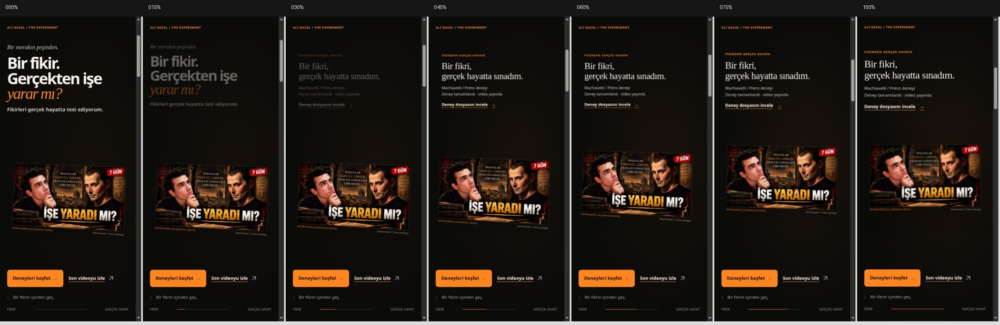
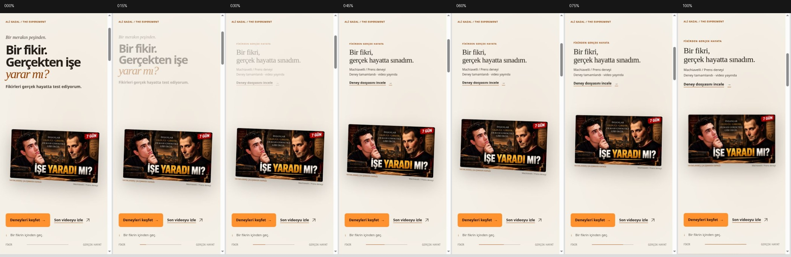
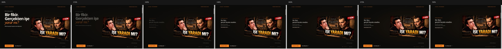
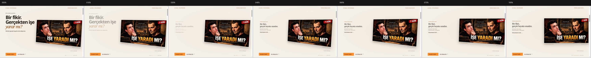

# Aşama 2.1 — V2 görsel düzeltme önizlemesi

Durum: **İncelemeye hazır güvenli düzeltme; sinematik kalite için kullanıcı onayı yok.**
Dal: `feature/homepage-cinematic-prototype-v1`, mevcut taslak PR #24.
Başlangıç commit'i: `18dcd4cbaad41374f6817e9784fb602d8bcf1d23`.
Main: `a1cc3a3504df5757eb4444215606f40e33fea76b`.

## Kök neden ve yapılan düzeltme

| Önceki sorun | Kaynak ilişkisi | V2 kararı |
| --- | --- | --- |
| FİKİ / kopuk harfler | İki ayrı `.hp-letter` kütlesi, 80vw font, perspektif ve kırpma | Büyük kelimeyi ve kanat sistemini tamamen kaldırdım. Küçük, tam FİKİR ilerleme etiketi kaldı. |
| Uzun merkez çizgi | Dönen `.hp-floor` içindeki %50 doğrusal gradyan | Zemin katmanı, gradyanı ve bütün hareket parametreleri kaldırıldı. |
| Üst/alt renk ayrımı | Dönen zemin, ayrı ışık şeritleri, medya halesi ve gövde dokusunun birleşimi | Sahneye özel grafit/krem taban, tek düşük yoğunluklu ışık alanı. Global tema renkleri değişmedi. |
| KARARA / yüzlerin çakışması | Karar yazısı ve kapak aynı perspektif hacmini paylaşıyordu | KARARA katmanı ve alt cümlesi kaldırıldı. Açıklama ayrı sol/üst bölgede. |
| Mobil boşluk / kırpılma | Masaüstü ölçülerinin dar alana taşınması | Dar kompozisyon 1000px'e kadar kullanılıyor. Kapak tam genişlik sınırı içinde; kamera mesafesi daha kısa. |

## Tek hareket tasarımı

Beğenilen soru, gerçek kapak, iki CTA ve başlangıçtaki yerleşim korunur.
Başlık harflere ayrılmaz; bütün olarak geriye çekilir. Kapağın bulunduğu
koordinat sistemi hafif yana hareket eden ve ileri yaklaşan kamerayla
izlenir. Kapak bütün hareket boyunca görünür; görsel değiştirilmez.
Orta bölümde bakış açısı artar, ardından açı sıfıra yaklaşır.
Final açıklaması kapaktan ayrı bir bölgede yerleşir ve **Deney dosyasını
incele** bağlantısı görünür olur. Görünmeyen araştırma bağlantısı odak
sırasına girmez; hareketsiz kullanımda normal akışta erişilebilir.

Kamera ilerlemesi masaüstünde 290, dar kompozisyonda 170 CSS px'tir.
Bu sayılar fiziksel lens ölçümleri değildir. Kaydırma mesafesi önceki
1200/850 yerine 950/650 px ek hareket alanıdır. Otomatik ışık girişi
kısa ve iptal edilebilir; scroll ile aynı transformları yönetmez.

## Görsel kanıt

390×844 ve 1440×900 CSS piksel gerçek Chromium iframe viewport'larında,
her iki temada %0 / 15 / 30 / 45 / 60 / 75 / 100 kaydedildi: **28 kare**.
1440 viewport çalışma ekranına %84 ölçekle sığdırıldı; 1440 CSS px
hesabı iframe içinde doğrulandı. Bunlar gerçek Android ekran görüntüleri değildir.

Kontrol edilen ana karelerde kapak kenarları kadrajda, iki CTA erişilebilir,
açıklama ve kapak ayrı bölgelerde. 320/360/430/768 genişliklerinde koyu
temada %0/30/60/100 için ayrıca **16 konum** kaydedildi; yatay taşma,
kapak kırpılması ve görünür açıklama/kapak çakışması bulunmadı.

İlk görsel kontrolden sonra tek odaklı düzeltme yapıldı: yanlışlıkla
kaybolan mobil kapak genişliği geri getirildi, sahne tabanı bütünleştirildi,
orta noktada açıklama daha erken yerleştirildi. 768px kontrolünde dar
kompozisyonun kullanılması sağlandı. Tasarım yeniden başlatılmadı.

## Hareketli ve teknik doğrulama

Gerçek wheel girişleriyle ileri ve geri hareket edildi:

- 390px: 0 → .3303 → .6626 → .9934 → .6626 → .3303 → 0.
- 1440px: 0 → .2261 → .4535 → .6798 → .4535 → .2261 → 0.

JavaScript kapalı sandbox, reduced-motion sorgusunu true döndüren yerel
kontrol belgesi, 390×500 kısa ekran ve %200 kök metin ile statik kullanım
ayrıca tarayıcıda denetlendi. Başlık, gerçek kapak ve araştırma bağlantısı
görünür; yatay taşma yok. Reduced-motion kontrolü gerçek işletim sistemi
ayarını değiştirmez; kontrollü sorgu fixture'ıdır. Bozuk medya fallback'i
VM testiyle doğrulandı.

Aşağıdaki kontroller başarılı:

- `node scripts/sync-site.js --check`
- `node scripts/build-archive.js --check`
- `node scripts/sync-seo.js --check`
- `node scripts/check-site.js`
- `node --test scripts/test-*.js`: **98/98**.

Başlangıçtaki hedefli testte `sin(π)` yuvarlama artığı nedeniyle final
rotasyonu tam sıfır değildi; final durumu açıkça sıfıra sabitlendi.
Bir toplu ek viewport kayıt çağrısı zaman aşımına uğradı; kaydedilmemiş
sonuçlar başarılı test sayılmadı. Yukarıdaki 16 ek konum daha küçük
bir kayıt turunda tamamlandı.

[28 ana konum / DOM](evidence/checks.json),
[16 ek konum](evidence/extra-checks.json),
[fallbackler](evidence/fallback-checks.json),
[wheel gözlemleri](evidence/wheel-checks.json),
[Node çıktısı](evidence/node-tests.txt).

## Korunan sınırlar

Ana sayfanın eski hero altındaki bölümü ve proje/araştırma dosyaları
byte düzeyinde korunuyor. `site-data.js`, global animasyon/tema dosyaları,
SEO, yayın tarihleri, Machiavelli V6.1 ve Control V2.2 değişmedi.
Payot PR #20'ye dokunulmadı. Güvenlik başlıkları ve dağıtım izin listesi
bu düzeltmede değiştirilmedi. Yalnız index koruma hash'i yenilendi.

## Görsel sınır ve dürüst değerlendirme

Belirgin kırpılma, dev yazı çarpışması, orta çizgi ve zemin ayrımı
sorunları temizlendi. Bununla birlikte yeni geçiş **temkinli ve sınırlı**:
özellikle mobilde derinlik etkisi ağırlıklı olarak kapağın açı/konum
ilişkisinden geliyor. Tam bir araştırma mekânından geçiliyormuş hissinin
ve istenen güçlü sinematik dönüşümün elde edildiğini iddia etmiyorum.
Orta bölüm hâlâ ilk karşılaşmadan daha az etkileyici. Bu nedenle teslimi
görsel olarak tamamlanmış ana sayfa olarak onaylamıyorum.

Gerçek Android/Infinix, Safari/iOS, işletim sistemi reduced-motion tercihi,
cihaz FPS/GPU ve saha LCP/INP/CLS ölçümleri yapılmadı. Kesintisiz ekran
videosu alınmadı; yedi konumlu kare dizisi ile gerçek ileri/geri wheel
kontrolü ayrı kanıtlardır. Yeni görsel denemelerle işi uzatmak yerine
onaylı açılışı koruyan bu güvenli revizyon incelemeye bırakılıyor.

Son commit, Cloudflare sürümü ve uzak önizleme kontrolü PR #24'ün
güncel teslim bölümünde yer alır. Main'e merge veya production yayını yok.
