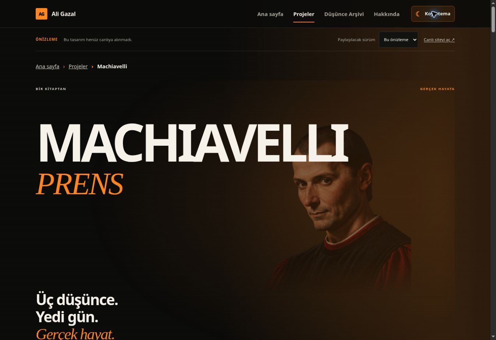
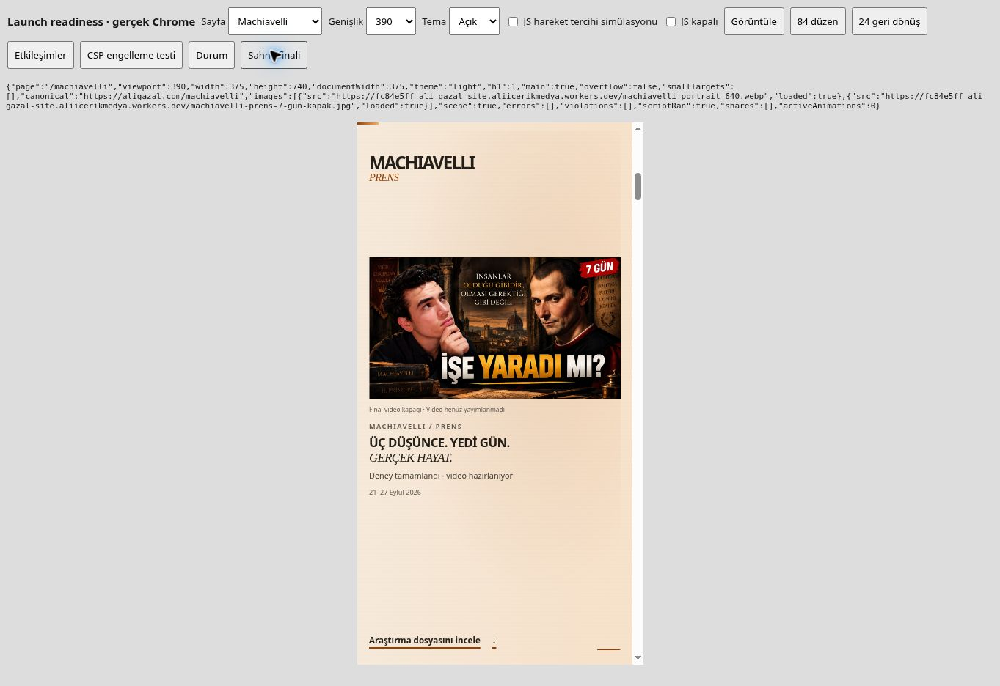

# Doğrulama ve önizleme kaydı

4 Kasım 2026. **Yalnız PR/önizleme; main, üretim, DNS ve hesap ayarları değiştirilmedi.**

## İncelenebilir ürün

- [Temiz önizleme — Machiavelli](https://chore-prelaunch-security-baseline-20261104-ali-gazal-site.aliicerikmedya.workers.dev/machiavelli)
- [Temiz önizleme — ana sayfa](https://chore-prelaunch-security-baseline-20261104-ali-gazal-site.aliicerikmedya.workers.dev/)
- [PR #13](https://github.com/aligazaltr/Ali-Gazal-Site/pull/13)

Bu sabit dal önizlemesi son commit'e ilerler. Kontrolleri yapılan ürün commit'i `317be8305e294dcb73763576eda476d24ce75109`, sürüm `5c92d1f2-7fde-46e5-ba5c-5efff6944da4`, Cloudflare build `3c7fc620-9c8a-4ddf-b050-1ea696d1ce92` (**success**). Son belge/kanıt commit'i ve onun temiz build'i PR açıklamasında kaydedilir. Test dalı ürün olarak teslim edilmez.

## Sonuçlar

| Kontrol | Sonuç | Kanıt |
| --- | --- | --- |
| Node | **57/57** | `evidence/node-tests.txt` |
| Veri/HTML, arşiv ve yeni SEO üretimi | `sync-site --check`, `build-archive --check`, `sync-seo --check`, `check-site` geçti | Node/build çıktıları |
| Resmî Wrangler ile uyumluluk | **4.157.0**, `deploy --dry-run` başarılı; gerçek deploy veya hesap ayarı değişikliği değil | `evidence/wrangler-dry-run.txt` |
| Altı sayfa × 7 viewport × 2 tema | **84/84**; 320/360/390/430/768/1024/1440 × 740 px. Yatay taşma, 24 px altı kontrol hedefi, beklenmeyen CSP/uygulama hatası yok | `evidence/browser-layout-84.json` |
| JavaScript kapalı | Altı sayfa × 390/1440: **12/12**. Sandbox'ta allow-scripts yok; içerik normal HTML akışında | `evidence/browser-fallbacks-24.json` |
| Hareket azaltma JS simülasyonu | Altı sayfa × 390/1440: **12/12**; Machiavelli normal akışa döndü, aktif WAAPI animasyonu yok | aynı dosya |
| Arama/filtre/keşif/odak/kaynak/paylaşım | **17/17**; Türkçe İRADE, boş sonuç, filtreli rastgele seçim, tekrarsızlık ve son tıklama davranışı dahil | `evidence/browser-behavior-17.json` |
| Zorunlu CSP | Inline canary **çalışmadı**; browser `script-src-elem`, blocked=`inline`, disposition=`enforce` kaydetti | `evidence/browser-csp-canary.json` |
| İlk aday HTTP | **26/27**. `/_headers` beklenmedik biçimde 200 ile politika dosyasını sundu; hata saklanmadı | `evidence/product-http-audit.json` |
| Düzeltilmiş aday HTTP | **27/27**. Altı sayfanın gerçek HTML/canonical/OG/header/noindex kontrolleri; görsellerin hash'leri; robots/sitemap; .html/slash davranışı; 404 ve özel/test dosyaları. `/_headers` artık 404, zorunlu CSP diğer yanıtlarda mevcut | `evidence/corrected-product-http-audit.json` |
| Tasarım ve içerik | **27 karşılaştırma aynı**: bütün CSS/animasyonlar, tema, görseller, arşiv kaynağı, body metinleri; veri dosyalarında yalnız origin değişir. Body'deki `data-share-url` hedefi bu karşılaştırmada izinli URL farkıdır | `evidence/protected-design-and-content.json` |
| Temiz önizleme gerçek UI | Tema yenilemede ve gezinmede korundu; araştırma linki, gerçek klavye ile arama, önizleme içinde ana sayfaya dönüş çalıştı; site kaynaklı konsol hatası yok | `evidence/clean-preview-smoke.json` |
| Mevcut canlı domain | Bayt karşılaştırması, DNS, erişim, ilk proxy hataları ve ek gözlemler ayrı kaydedildi | `evidence/production-http.json`, `dns.json`, `tls.json`, `http-retry-and-preview.json` |

Matris viewport genişliğini `window.innerWidth` olarak kaydeder. Bu Chrome'da klasik 15 px scrollbar içeriğin `clientWidth` değerini azaltır; her iki değer ham kayıtta bulunur. Bu bir Android donanım/UA testi değildir. 24 px kontrol taraması tam WCAG sertifikası veya tüm inline metin bağlantılarının 44 px olduğu iddiası değildir.

Matris geçme ölçütü anlık `image.complete` değeri değildir: ilk örneklerde altı görsel okuması henüz tamamlanmamıştı. Kırık görsel sonucu çıkarılmadı. Portre ve gerçek kapak daha sonra ayrı HTTP/hash kontrollerinde, temiz sayfada ve aşağıdaki görsel incelemede yüklü olarak doğrulandı.

Kopyalama/native-share payload denetimleri test çiftleriyle yapıldı; gerçek OS menüsü/clipboard ve WhatsApp/Telegram/Discord/Facebook/X önizleme önbelleği test edilmedi. Önizleme linkleri aynı origin'de; açık üretim seçimi `https://aligazal.com/machiavelli` üretiyor.

## Kanıtların kaynağı ve sınırlar

- İlk PR #13 (`8cac379`) → Report-Only önizleme `42160fe8`: gerçek HTTP başlıkları ve Chrome tema/arşiv gözlemi.
- Ürün `74b7c21` → temiz `eb69ec6d`: zorunlu CSP ve domain geçişi.
- Ayrı QA dalı `qa/launch-readiness-20261104`, düzeneğin commit'i `245f5d5` → `fc84e5ff`: aynı ürün dosyaları/politika üzerine yalnız dış test scriptleri ve iframe kontrol paneli. 84/24/17/CSP testleri burada yapıldı.
- `317be83` → `5c92d1f2`: kamu varlıkları tam izin listesine alındı, `_headers` metaveri istisnası kaldırıldı. CSP ve tasarım kodu QA testindekiyle aynı. Yeni kapalı izin listesi, 57 Node testi, gerçek HTTP 27/27 ve temiz UI kontrolüyle tekrar doğrulandı.
- Wrangler kaynak incelemesi ve istisna hatası: `evidence/headers-metadata-investigation.json`. `_headers` gizli credential içermiyordu; yine de metaveriyi kamu asset'i yapmamak gerekir.
- Console'daki `chrome-extension://…` metadata mesajları site hatası olarak sayılmadı. QA canary'nin tek beklenen CSP ihlali, normal kullanımda ihlal olmadığı sonucundan ayrı tutuldu.
- Gerçek ekran okuyucu ile dinleme, fiziksel Android/iPhone, Safari/Firefox, OS/CSS media emülasyonu, Lighthouse ve saha LCP/INP ölçümü yok. Browser AX/DOM başlıkları, menü/etiketler, klavye ve odak temel denetimi yapıldı; tam erişilebilirlik uygunluğu iddia edilmez.
- Hesap içi Cloudflare/GitHub/Google işlemleri yapılmadı. HSTS, preload, WAF/2FA veya Search Console aktifmiş gibi sunulmadı.

## Gerçek ekran görüntüleri

Masaüstü görüntüsü temiz `eb69ec6d` ürününden, telefon görüntüsü `fc84e5ff` QA iframe'inden. Son ürünün aynı tasarım dosyalarıdır; maket veya üretilmiş arayüz görüntüsü değildir. Telefonun gri dış alanı test arayüzüdür. Görseller kırpılmadı/yeniden çizilmedi.

[Genel rapor](REPORT.md) · [Panel ve işletim adımları](OPERATIONS.md)
